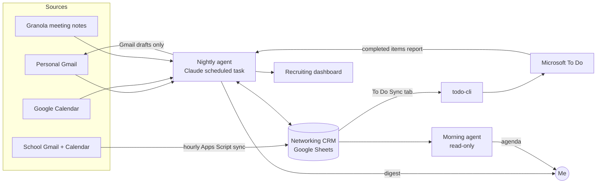

# Career OS: an AI chief of staff for MBA recruiting

> I'm a first-year MBA recruiting for GTM, BD and product roles in AI and defense tech. That means 4+ networking chats a week, two inboxes, two calendars, meeting notes, deadlines and follow-ups, and things were falling through the cracks. Nobody was going to build me a tool for that, so I designed one: an agent system that runs every night, keeps my CRM and dashboard current, drafts my follow-ups for approval, and emails me what matters.

**Status:** in daily use since October 2026 · **Built with:** Claude (agent and scheduled tasks), MCP connectors, Google Sheets, Python, TypeScript

---

## The problem

Recruiting runs on relationships, and relationships run on follow-through. The work is spread across:

- **Two Gmail accounts and two calendars** (personal and school) that don't talk to each other
- **Meeting notes** in Granola that never made it into a tracker
- **Deadlines** spread across career portals, club calendars and email
- **Follow-ups** that depend on remembering what we talked about three weeks ago

A spreadsheet CRM goes stale within a week if a person has to update it by hand. What I needed was something that does the bookkeeping and leaves me the judgment calls.

## What it does

| Every night (7:58 PM) | Every morning (6:48 AM) |
|---|---|
| Reads new mail, calendar events and meeting notes from both accounts | Reads the CRM and today's calendar (read-only) |
| Logs chats held, new contacts, replies and status changes in the CRM | Emails a short agenda covering today's chats, items due today and overnight replies |
| Writes prep briefs for chats in the next 48 hours | Flags any chat that has no prep brief |
| Drafts thank-yous and follow-ups in my voice as **Gmail drafts only** | |
| Refreshes the recruiting dashboard (timeline, next steps, blockers, tracks) | |
| Syncs next steps into Microsoft To Do | |
| Emails and pushes a nightly digest, with the most important item first | |

*The recruiting dashboard the nightly agent keeps current: deadlines, overdue items, blockers and questions only I can answer.*

## Architecture

More detail, including why each piece exists, is in [`docs/architecture.md`](docs/architecture.md).

## Design decisions (the product part)

1. **Human in the loop for anything outbound.** The agent never sends email, never accepts invites and never deletes anything. Everything outbound goes out as a draft that I review. Trust is the product: one bad auto-sent email to a recruiter would cost more than a hundred saved minutes.
2. **One writer, many readers.** Only the nightly task edits the CRM and dashboard. The morning task only reads them. That avoids race conditions and duplicate rows, and makes it clear where to look when something goes wrong.
3. **Evidence before status changes.** A chat is marked "Held" only if there's a meeting note, a confirming email or my say-so. Otherwise it's "Needs confirmation." The agent never guesses who said what in an unlabeled transcript.
4. **Meet constraints where they are.** My school account blocks third-party OAuth apps. I first built a local multi-account Gmail connector ([`connectors/gmail-mcp`](connectors/gmail-mcp)), then moved to an hourly script inside the school account that writes mail and calendar data to the sheet, so the whole system runs in the cloud without my laptop.
5. **Start light and grow.** V1 was a Google Sheet plus an agent prompt, so it worked on my phone from day one. A dashboard, a To Do sync and a morning brief were each added when a real gap showed up.
6. **Measurable goal.** The system tracks one-on-one chats against a target of 4 per week (group events don't count) and suggests specific warm contacts when I'm behind.

## What's in this repo

| Folder | What it is |
|---|---|
| [`agents/`](agents) | The nightly and morning agent instructions (sanitized). These are the "source code" of the system. |
| [`docs/`](docs) | Architecture, CRM schema and dashboard data model |
| [`dashboard/`](dashboard) | Dashboard dataset formats, with fictional sample data |
| [`todo-cli/`](todo-cli) | Python CLI (no dependencies) that signs into Microsoft Graph and syncs dashboard steps into a To Do list idempotently, never creating duplicates |
| [`connectors/gmail-mcp/`](connectors/gmail-mcp) | Multi-account Gmail MCP server, forked and hardened: read and draft only, Windows sign-in fix, wrong-account guard, thread-aware drafts |
| [`connectors/school-sync/`](connectors/school-sync) | Google Apps Script that runs inside the school account and mirrors mail, calendar and the To Do export into the CRM every hour |

## Results so far

In the first four weeks (Sept 30 – Oct 26, 2026):

| | |
|---|---|
| Contacts tracked | **48**, with new ones added by the agent from intros, bookings, events and replies |
| Interactions logged | **62**: chats, intros, conference conversations, company presentations |
| Follow-up drafts written | **41**, all held as drafts for my review; none sent automatically |
| Automated runs | **35** logged CRM updates |
| Chat prep | A prep brief for every 1:1 in the next 48 hours, written into the CRM |

**One example:** when a scheduled call didn't happen, the next run caught it from my meeting notes, kept the prep brief for the new slot, pulled the contact's stated availability from email, and had a reschedule note drafted before the morning agenda arrived.

## What I learned

- **The prompt is the spec.** Writing the agent instructions forced the same decisions a PRD does: who owns which data, which errors are acceptable, and which actions need a human.
- **Idempotency matters more than intelligence.** Most early bugs were duplicates (same contact added twice, same task synced twice). Stable IDs and "update, don't append" rules fixed more than better prompting did.
- **Enterprise constraints shape the architecture.** The school-account OAuth block is a small version of what every AI tool hits in a regulated environment, and it's the same problem I saw from the government side.

## What's next

- Rank warm-intro paths across the network graph (who can introduce me to whom)
- Weekly retro: which outreach channels convert to chats
- Package the CRM template so classmates can run their own copy

---

*Built by Chris Smith-Burks, Wharton MBA/Lauder '28, previously at the Defense Intelligence Agency and the DoD CDAO. I designed the system and wrote the specs and agent instructions; I built the code with Claude as a pair programmer.*
