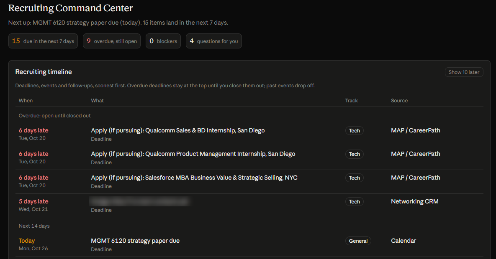

# Recruiting dashboard

A Claude Dashboard artifact that renders four JSON datasets: a timeline, next steps, blockers/questions and track progress. The nightly agent is the only writer. Each update reads the current version, edits rows by stable `id`, uploads the new file and swaps the pointer with an `if_version` check.

`sample-data/` holds **fictional** data in the production format. Schema: [`../docs/data-model.md`](../docs/data-model.md).

