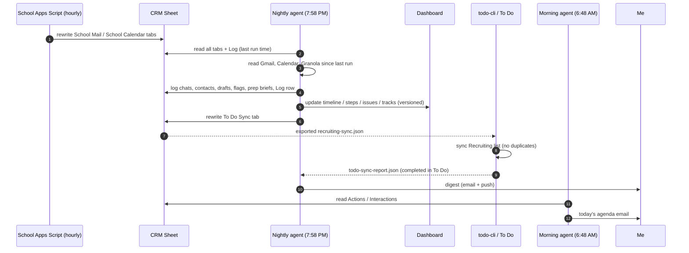

# Architecture

## Components

| Component | Tech | Role | Writes to |
|---|---|---|---|
| Nightly agent | Claude scheduled task, cloud | The only writer: updates the CRM and dashboard, writes drafts, sends the digest | CRM, dashboard, Gmail drafts, To Do Sync tab |
| Morning agent | Claude scheduled task, cloud | Read-only agenda | One email to the owner |
| Networking CRM | Google Sheets | System of record for contacts, interactions, actions, drafts, settings and the log | — |
| School sync | Google Apps Script inside the school account, hourly | Gets around the OAuth block by writing 7 days of mail and 22 days of calendar to two sheet tabs | `School Mail`, `School Calendar` tabs |
| Recruiting dashboard | Claude Dashboard artifact + 4 JSON datasets | Visual timeline, next steps, blockers and track progress | — |
| todo-cli | Python 3, standard library only, Microsoft Graph | Idempotent sync of dashboard steps into Microsoft To Do; reports items I finished in To Do | To Do, `todo-sync-report.json` |
| gmail-mcp | TypeScript MCP server | V1 path to both inboxes from the desktop (now retired for the cloud runs) | Gmail drafts |

## Data flow

## Why it's built this way

**Sheets as the database.** The CRM is readable and editable on a phone, auditable row by row, and every connector already speaks it. The cost is weak constraints, so the agent instructions enforce them instead: stable IDs, no reused IDs, allowed status values, check before append.

**Versioned writes on the dashboard.** Each dataset update carries the version it read (`if_version`). If something else changed the data in the meantime, the write fails instead of overwriting.

**Cloud-only runtime.** V1 depended on a local Gmail MCP server, so the system broke whenever my laptop was asleep. Moving the school-account access into an Apps Script that runs inside that account removed the laptop entirely.

**Failure handling.** Every run ends by naming any source it couldn't reach. Stale school data is labeled "unknown, may have gone from school mail" rather than treated as missing, so a sync outage can't produce wrong "you never replied" flags.
